# Anomaly Inspector

[](https://github.com/you-ssef-dan/anomaly-inspector/actions/workflows/ci.yml)
[](https://github.com/you-ssef-dan/anomaly-inspector/actions/workflows/model-ci.yml)
[](https://github.com/you-ssef-dan/anomaly-inspector/actions/workflows/cd.yml)


[](https://github.com/you-ssef-dan/anomaly-inspector/releases)

**Visual inspection for factory parts: it learns what a good part looks like, flags the ones that are
not, and draws a heatmap showing where the defect is.** Built end to end on a CPU laptop, from raw
images to a tested, versioned pipeline.

**Live demo: [anomaly-inspector-5fe2.onrender.com](https://anomaly-inspector-5fe2.onrender.com)**.
Upload a photo of a bottle and see the decision and the heatmap ([how it is deployed](#live-on-render)).
It runs on a free plan, so the first visit can take about a minute to wake it up.

> **Status: work in progress.** Data, models, metrics, experiment tracking, the DVC pipeline, the
> ONNX export, the API, its Docker image (public on GHCR), a live demo, [CI/CD](#cicd) with
> model quality gates, and [retraining and batch inspection with Airflow](#retraining-and-batch-inspection-with-airflow)
> are done; tests for the DAGs in CI and monitoring come next. See the [roadmap](#roadmap).

## The idea

Real factories have very few defective parts, and new kinds of defects keep appearing. So instead of
learning "what a defect looks like", the models learn **what a good part looks like**, from good
images only, and flag anything that differs, including defects they have never seen.

| Model | How it works | Training |
| --- | --- | --- |
| **PatchCore** | Stores the features of small patches of good images. A new patch far from every stored one is suspicious; those distances form the heatmap. | None: one pass over the good images |
| **STFPM** | A student network learns to copy a frozen teacher on good images. Where it copies badly, the image is anomalous. | A real PyTorch training loop with early stopping |

Both are written from the papers in this repo ([`models/`](src/anomaly_inspector/models),
[`training/`](src/anomaly_inspector/training)). PatchCore is also checked against the reference
implementation in [anomalib](https://github.com/open-edge-platform/anomalib).

## Results so far

Dataset: [MVTec AD](https://www.mvtec.com/research-teaching/datasets/mvtec-ad), three categories
(bottle, carpet, screw). This repo's PatchCore (WideResNet-50, 256 px, 1% memory bank), scored on
`holdout`, the split that no decision has touched:

| Holdout | Images (good + defective) | Image AUROC | Pixel AUROC | AUPRO | ms per image |
| --- | --- | --- | --- | --- | --- |
| Bottle | 10 + 32 | 1.0000 | 0.9862 | 0.9410 | 99 |
| Carpet | 14 + 45 | 0.9873 | 0.9896 | 0.9420 | 104 |
| Screw | 21 + 59 | 0.8918 | 0.9778 | 0.8852 | 107 |

- **AUPRO** counts every defect region equally, however small, so it is the metric that cares about
  tiny defects. Screw is the hard category: tiny defects on parts lying at any angle.
- Each row comes from the DVC pipeline (`dvc repro`), which writes it to
  `reports/patchcore/<category>/metrics.json`; the model is registered in MLflow as the current
  `champion` of its category (see [tracking](#tracking-and-model-registry)).
- The holdout sets are small: with 21 good screws, a single image can move image AUROC by up to
  1/21, about 5 points.
- Latency is the model alone, on a laptop CPU (Intel Core Ultra 5 125H), batch 8. It depends on
  what else the machine is doing: the same screw model measured 169 ms during the experiments.

**Checked against anomalib.** On bottle's full test set, with identical inputs, splits, coreset size,
seed and metric code (anomalib's backbone gets the same ImageNet weights), the two implementations
differ by less than 0.001:

| Bottle, full test set (83 images) | Image AUROC | Pixel AUROC | AUPRO |
| --- | --- | --- | --- |
| PatchCore (this repo) | 1.0000 | 0.9866 | 0.9413 |
| anomalib PatchCore | 1.0000 | 0.9868 | 0.9417 |

- Our AUPRO code agrees with anomalib's to 5 decimals on the same maps (a slow test checks it).
- Full numbers: [`reports/anomalib_benchmark.json`](reports/anomalib_benchmark.json). The data and
  its limits are described in the [data card](docs/data_card.md).

## What changes the result

18 experiments per category, each changing one setting of the PatchCore baseline (WideResNet-50,
256 px, 1% memory bank), plus one combination of two changes. Scored on the `calib` split, so
`holdout` stays untouched.

| Question | Bottle (easy) | Screw (hard) |
| --- | --- | --- |
| **How much does a smaller memory bank cost?** | Almost nothing: 100× smaller, AUPRO 0.944 → 0.934 | A lot: AUPRO 0.916 → 0.865 → **0.546** at 10% / 1% / 0.1% |
| **How many good parts does a new line need?** | One image already gives image AUROC 0.99 | About **50**, at different angles |
| **What does a faster backbone cost?** | AUPRO −0.008, **5× faster** | Nothing measurable, **2.5× faster** |
| **Do small defects need more resolution?** | A little: AUPRO 0.942 → 0.953 | **Yes**: AUPRO 0.865 → **0.941** |

<picture>
  <source media="(prefers-color-scheme: dark)" srcset="reports/figures/experiment_size_dark.png">
  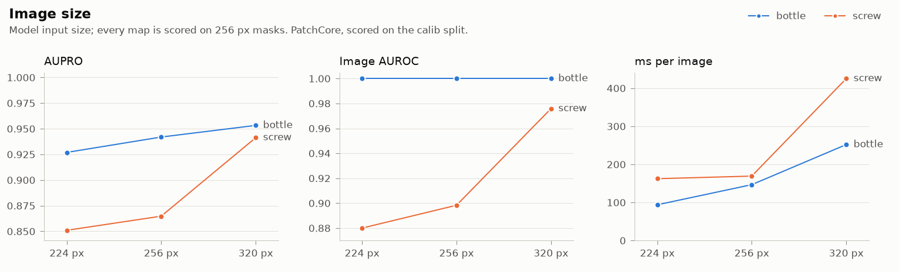
</picture>

The two cheap wins together, **ResNet-18 at 320 px**, give screw an AUPRO of **0.962** (baseline
0.865) at **38 ms per image** (baseline 169). It was picked after looking at `calib`, so it still has
to be confirmed on `holdout`. All findings and their limits: [`docs/experiments.md`](docs/experiments.md).

## Where it still fails

Screw, the four defects PatchCore comes closest to missing (top) and the four good parts it comes
closest to rejecting (bottom). The white outline is the real defect, the orange wash is the model's
map.

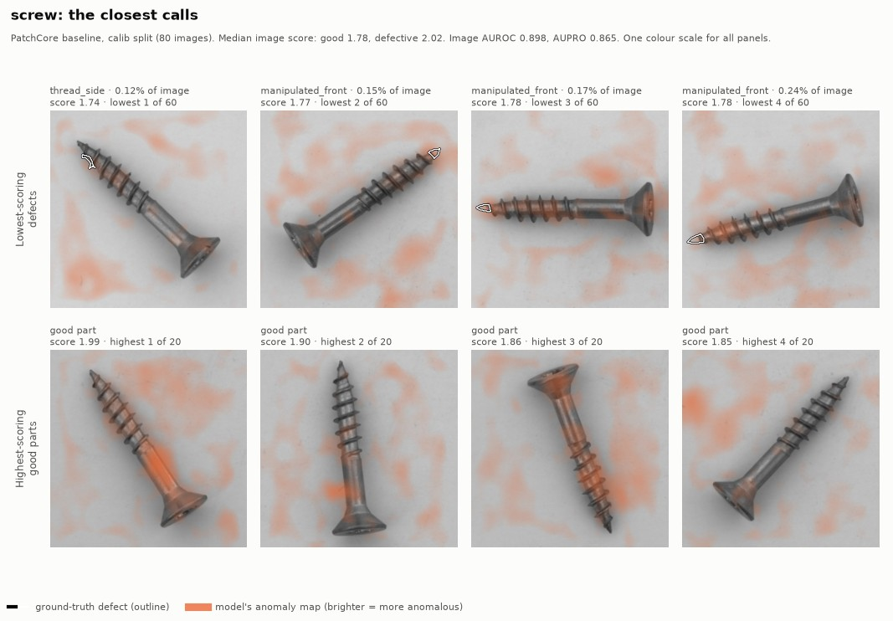

- The missed screw defects are tiny (0.12 to 0.24% of the image) and the map's peak is **not** on
  them, which is why more resolution helps.
- Bottle has no real failure; carpet's misses are thin threads that score like good weave.
- Every panel is explained in [`reports/failure_notes.md`](reports/failure_notes.md), with guesses
  marked as guesses.

## Tracking and model registry

When a server is configured, every evaluation in the pipeline is logged to
[MLflow](https://mlflow.org) (server and PostgreSQL in Docker Compose), so any number above can be
traced back to what produced it:

| Logged | What |
| --- | --- |
| Tags | git SHA, whether the code had uncommitted changes, DVC data hash, md5 of the model file, category, CPU model |
| Params | every value of `params.yaml` |
| Metrics | holdout image AUROC, pixel AUROC, AUPRO, ms per image; CPU and RAM over time |
| Artifacts | `threshold.json`, ROC and PRO curves, the holdout failure gallery |
| Model | the ONNX file that serves, registered as a new version of `patchcore-<category>` by [`pipelines/register.py`](src/anomaly_inspector/pipelines/register.py), outside the pipeline, so re-running a stage never adds a version |

**Promotion is code, not a click.** Each new version becomes the `challenger`.
[`should_promote`](src/anomaly_inspector/registry.py) makes it the `champion` only if it was trained
from committed code, stays under the latency budget (200 ms per image), and is not worse than the
current champion: image AUROC not lower, AUPRO at most 0.005 lower. Anything downstream loads
`models:/patchcore-screw@champion`, never a version number. Reloading each champion in a fresh
session reproduces its logged holdout AUROC exactly.

The `threshold.json` of each run holds the decision threshold, chosen on `calib` with a missed
defect assumed to cost 10 times a false reject, and, for comparison, the 99th percentile of good
parts' scores (the option for a new line that has no defect images yet).

The Phase 2 experiments are in MLflow too. All 19 screw runs, one line each, coloured by AUPRO: the
dark red line is ResNet-18 at 320 px, both the fastest run and the most accurate.

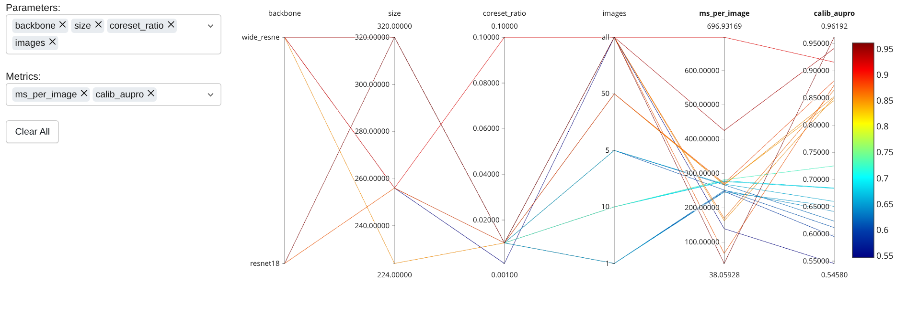

And how many good images a new line needs (3 random subsets per count): with 1 to 10 images AUPRO
stays below 0.73; with 50 it is 0.845 to 0.882 (all 230 images: 0.865).

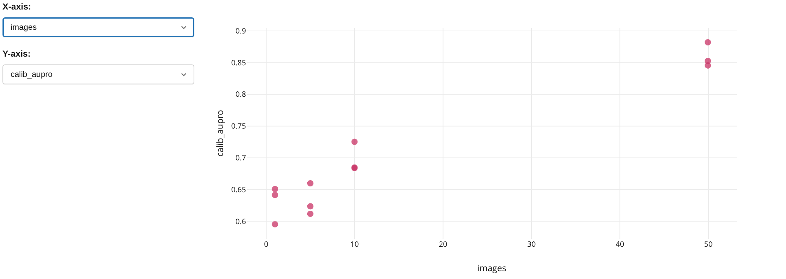

## From PyTorch to ONNX

The pipeline exports each model to [ONNX](https://onnx.ai): one file that runs in ONNX Runtime
without PyTorch, and carries its own threshold, image size, category and git SHA. The export
stage scores the ONNX model on `holdout` and fails if it differs from PyTorch by 0.001 or more;
it doesn't (same image AUROC, AUPRO within 0.0000003).

A second stage tries **INT8**: the convolutions are stored and computed in 8 bits, calibrated on
100 good `train` images; the distances to the memory bank stay in 32-bit floats. Then all three
versions are timed the same way. Screw:

| Screw | ms per image, batch 1 (p50 / p95) | Images per s, batch 8 | File | Image AUROC | AUPRO |
| --- | --- | --- | --- | --- | --- |
| PyTorch FP32 | 108 / 127 | 8.5 | 114 MB | 0.8918 | 0.8852 |
| ONNX Runtime FP32 | 90 / 93 | 11.2 | 114 MB | 0.8918 | 0.8852 |
| ONNX Runtime INT8 | 77 / 78 | 13.3 | 40 MB | 0.8870 | **0.8538** |

- **ONNX FP32 is free speed**: identical scores, about 1.2× faster per image, a much steadier p95,
  and a third more images per second in batches. The same holds for bottle and carpet.
- **INT8 is 3× smaller and about 15% faster again, but it blurs the heatmap.** It still tells good
  from defective parts (image AUROC within 0.005), yet AUPRO drops on every category: screw 0.885 →
  0.854, bottle 0.941 → 0.764, carpet 0.942 → **0.550**. The heatmap is half of what this system
  delivers, so **the FP32 ONNX model is the one that serves**; INT8 stays a measured option.
- Intel Core Ultra 5 125H, 4 threads for every version, on mains power with nothing else running;
  the model only, after 5 warm-up calls, 30 timed calls each. All numbers:
  `reports/patchcore/<category>/benchmark.json`.

## The API

A [FastAPI](https://fastapi.tiangolo.com) service answers "is this part defective, and where?". It
serves the ONNX model with ONNX Runtime, so it needs no PyTorch (a test checks that it never
loads it), and reads the threshold and image size from the model file.

| Method | Path | Answer |
| --- | --- | --- |
| GET | `/health/live` | The process is up, and the build (release) of the image it runs |
| GET | `/health/ready` | The model is loaded (503 until then) |
| GET | `/v1/model` | Category, threshold, image size, model version |
| POST | `/v1/predict` | One photo: anomaly score, decision and, with `?heatmap=true`, the heatmap |
| POST | `/v1/predict/batch` | Up to 8 photos in one model call |
| GET | `/` | A demo page: pick a photo, see the decision, the score against the threshold and the heatmap |

```bash
API_MODEL_PATH=models/patchcore/screw/model.onnx uv run uvicorn anomaly_inspector.serving.app:app
curl -F "file=@part.png;type=image/png" localhost:8000/v1/predict   # or open localhost:8000/docs
```

A photo that is not PNG or JPEG gets a 415, one above 5 MB a 413, one that cannot be decoded a
422; each error names the file. The model loads once, at startup, and a model without its
metadata stops the startup. The tests run the endpoints against a fake model, and end to end
against a small real one; slow tests check the real bottle model (a good part passes, a broken
one is rejected, a black square pasted on a good part raises its score).

### Load test with Locust

[Locust](https://locust.io) simulates many clients calling the API at the same time and measures
response times, throughput and errors. Here each simulated user is a camera that sends a screw
photo from `holdout` about once a second ([`tests/load/locustfile.py`](tests/load/locustfile.py)).
The API runs on 2 CPU cores, the size of the container in the next phase:

```bash
API_MODEL_PATH=models/patchcore/screw/model.onnx API_THREADS=1 \
  taskset -c 0,1 uv run uvicorn anomaly_inspector.serving.app:app --port 8000 --workers 2
uv run locust -f tests/load/locustfile.py --host http://localhost:8000 \
  --headless -u 10 -r 2 -t 2m --csv reports/load/w2-t1
```

| On 2 cores | Cameras | Photos per s | p50 | p95 | Errors |
| --- | --- | --- | --- | --- | --- |
| 1 worker × 2 ONNX threads | 10 | 5.8 | 680 ms | 1.1 s | 0 |
| 2 workers × 1 ONNX thread | 10 | 5.9 | 650 ms | 1.0 s | 0 |
| 2 workers × 1 ONNX thread | 5 | 3.7 | 320 ms | 480 ms | 0 |

- **2 cores handle about 6 photos per second.** 10 cameras ask for about 10, so photos queue and
  the median wait doubles. With 5 cameras every photo is served, with a p95 under half a second.
- **2 workers with 1 thread each** is slightly faster here, but each worker holds its own copy of
  the model: inside the 1 GB container it peaks at 1021 MB. The Docker image therefore runs
  **1 worker with 2 threads**, as fast there (5.4 photos per second) with a 690 MB peak. Workers ×
  threads stays at the number of cores, so they never fight over them.
- A request includes the upload, decoding a 1024 px photo, preprocessing and the model. Intel Core
  Ultra 5 125H, on mains power. Full numbers: [`reports/load/`](reports/load).

### In Docker

The API image ([`docker/api.Dockerfile`](docker/api.Dockerfile)) is built in two stages: one
installs the dependencies with uv, the other keeps only them and one category's ONNX model.

| API image | |
| --- | --- |
| Size | **432 MB** on disk, about 200 MB to download (Python 133 MB, libraries 214 MB, model 109 MB) |
| PyTorch | none: only ONNX Runtime, numpy and Pillow |
| User | `app`, uid 10001, not root |
| Health check | healthy once `/health/ready` answers, that is once the model is loaded |

```bash
make api-up        # builds it and starts it with 2 CPUs and 1 GB; demo page at http://localhost:8000
make smoke         # ready? a good bottle passes? a broken one is rejected?

# the proofs behind the table
docker run --rm --entrypoint python anomaly-inspector-api -c \
  "import sys, anomaly_inspector.serving.app; assert 'torch' not in sys.modules"
docker run --rm --entrypoint id anomaly-inspector-api      # uid=10001(app)
```

`docker image ls` shows 660 MB: Docker's image store counts the unpacked layers and their
compressed copies together. A separate training image ([`docker/train.Dockerfile`](docker/train.Dockerfile),
about 3 GB with CPU PyTorch) holds no code: it runs the pipeline on the repository mounted into it.

### Published on GitHub Container Registry

The API image is public on
[GHCR](https://github.com/users/you-ssef-dan/packages/container/package/anomaly-inspector-api),
GitHub's registry for container images. It runs anywhere with Docker, without the repository or
the data:

```bash
docker run --rm -p 8000:8000 ghcr.io/you-ssef-dan/anomaly-inspector-api:0.1.0
# then open http://localhost:8000 (demo page) or http://localhost:8000/docs
```

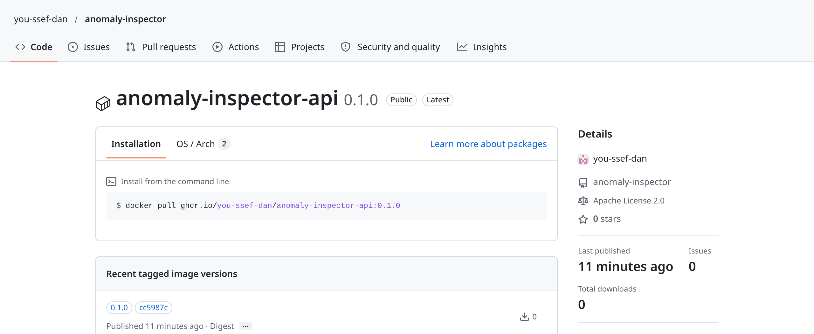

| Tag | Means | Used for |
| --- | --- | --- |
| `0.1.0` | the first release (bottle model) | what people and deployments ask for |
| `cc5987c` | the commit it was built from | knowing exactly which code and model are inside |

Both tags name the same image (one digest). There is no `latest` tag: it moves with every build,
so a deployment pinned to it would change without anyone deciding it.

How it was published, once and by hand (since phase 8, a release does it: see [CI/CD](#cicd)):

```bash
# 1. give the gh CLI token the right to push packages, and log Docker in to GHCR with it
gh auth refresh -h github.com -s write:packages
gh auth token | docker login ghcr.io -u you-ssef-dan --password-stdin

# 2. build from a clean main and name the image: registry/owner/name:tag
docker compose --profile api build api
SHA=$(git rev-parse --short HEAD)
docker tag anomaly-inspector-api ghcr.io/you-ssef-dan/anomaly-inspector-api:0.1.0
docker tag anomaly-inspector-api ghcr.io/you-ssef-dan/anomaly-inspector-api:$SHA

# 3. push (about 200 MB); the second push only adds a tag, the layers are already there
docker push ghcr.io/you-ssef-dan/anomaly-inspector-api:0.1.0
docker push ghcr.io/you-ssef-dan/anomaly-inspector-api:$SHA
```

4. **Make it public.** A new package starts private, and a private image cannot be pulled without
   logging in. On the package page: *Package settings* → *Change package visibility* → *Public*.
   *Connect repository* links it to this repository, so it shows on the repository page.
5. **Check it as a stranger would**, logged out, with the smoke test (it needs the MVTec bottle
   photos):

   ```bash
   docker logout ghcr.io
   docker run -d --rm -p 8001:8000 --name ghcr-check ghcr.io/you-ssef-dan/anomaly-inspector-api:0.1.0
   scripts/smoke_test.sh http://localhost:8001   # ready, a good bottle passes, a broken one is rejected
   docker stop ghcr-check
   ```

- **Why GHCR:** same GitHub account, the package sits next to the code, and GitHub Actions can push
  to it with its built-in token. A company would more often use its cloud's private registry
  (Artifact Registry, ECR) for access control, vulnerability scans and no pull limits; only the
  host name and the login command change.
- The package page also lists two **untagged** versions. They are part of the image: Docker pushes
  an index that points to the linux/amd64 image and to a build attestation (how it was built).
  Deleting them breaks the image.

### Live on Render

The same image runs on [Render](https://render.com)'s free plan:
**https://anomaly-inspector-5fe2.onrender.com** (the API docs are at `/docs`).

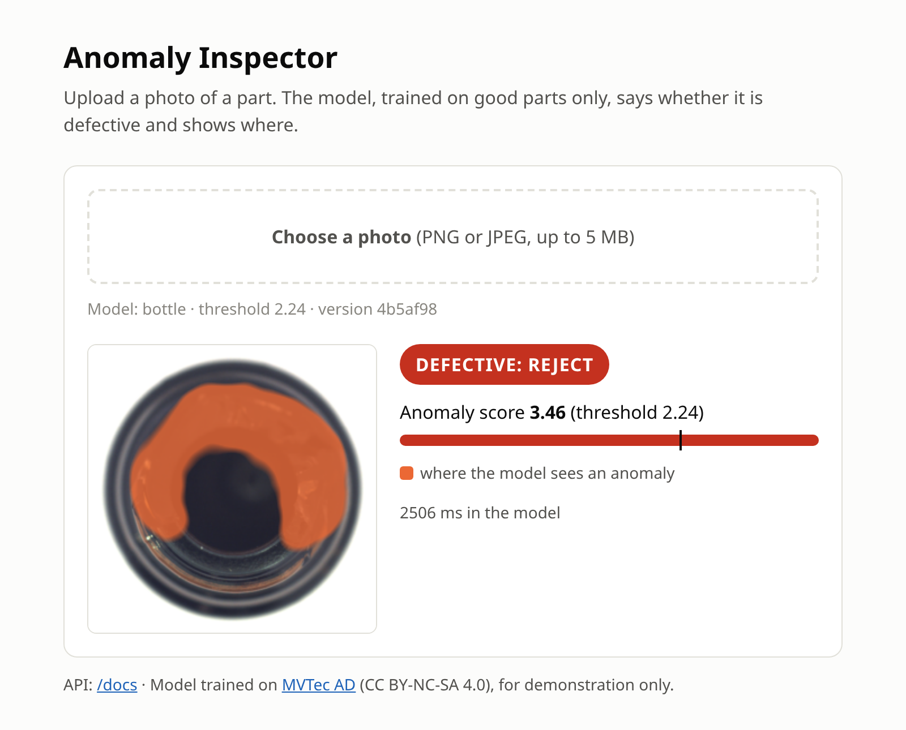

| Render setting | Value | Why |
| --- | --- | --- |
| Source | existing image `ghcr.io/you-ssef-dan/anomaly-inspector-api:0.1.0` | the image tested above, pinned to a tag; each release now deploys its own tag through the deploy hook |
| Instance | Free: 0.1 CPU, 512 MB of RAM, Frankfurt | no cost |
| `PORT` | `8000` | where the app listens (Render expects 10000 by default) |
| `API_THREADS` | `1` | a second ONNX thread does not help on 0.1 CPU |
| Health check path | `/health/ready` | no traffic before the model is loaded |

- **Slow, but enough for a demo.** A photo with its heatmap takes about 3.3 s end to end, 2.5 s of
  it in the model, against 0.2 s on the laptop's 2 cores. The app uses 359 MB of the 512 MB. Both
  were checked before deploying, by running the image locally with the same limits
  (`docker run --cpus 0.1 --memory 512m -e API_THREADS=1 ...`).
- **It sleeps.** After 15 minutes without visits Render stops it, and the next visit waits about a
  minute while it starts again.
- **Checked like the local container**, with the same smoke test:
  `scripts/smoke_test.sh https://anomaly-inspector-5fe2.onrender.com`.
- **Deploys are releases** ([`cd.yml`](.github/workflows/cd.yml), details in [CI/CD](#cicd)).
  Publishing a release such as `v0.2.0` builds the image with the real model, smoke-tests it and
  pushes it to GHCR as `0.2.0`; once approved, it triggers Render's deploy hook with that tag,
  waits until `/health/live` reports the new build, and smoke-tests the live URL. Render's own
  *Manual Deploy* button would deploy the tag in Render's settings (`0.1.0`), so a redeploy goes
  through `gh workflow run cd.yml --ref v0.2.0`.
- **Rollback.** Fast: on Render, *Deploys* → the last good deploy → *Rollback*. A release is built
  once and its tag never overwritten, so the same image comes back; check it with
  `curl …/health/live`, which shows the build. Through CI: `gh workflow run cd.yml --ref <last good
  release>`, which finds that image on GHCR and redeploys it after approval, without rebuilding.
  Either way, the fix then goes to `main` in a pull request, and the next release ships it.
- **Why Render:** its free plan runs an existing image at no cost. Google Cloud Run would be faster
  (2 CPUs, about 0.2 s per photo, scales to zero) and is what a production deployment would use;
  moving there is one `gcloud run deploy` with the same image.

<details>
<summary><b>Deploy it on Render yourself, step by step</b></summary>

You need a GitHub account. The free plan costs nothing, but Render may ask for a card to verify
the account: it places a temporary $1 authorisation, not a charge.

1. **Sign up** at [dashboard.render.com/register](https://dashboard.render.com/register) with GitHub.
2. **Create the service:** *+ New* → *Web Service*, then under *Source Code* choose *Existing Image*.
3. **Image URL:** `ghcr.io/you-ssef-dan/anomaly-inspector-api:0.1.0`. The image is public, so leave
   the credentials empty and click *Connect*.
4. **Settings:**
   - *Name*: it becomes `<name>.onrender.com`. Render adds a random suffix if another account
     already uses that name, and the subdomain cannot be changed later.
   - *Region*: the closest one (Frankfurt here). *Instance type*: *Free*.
   - *Environment variables*: `PORT` = `8000` and `API_THREADS` = `1`.
   - *Advanced* → *Health Check Path*: `/health/ready`. Leave *Docker Command* empty: the image
     already starts uvicorn.
5. **Click *Deploy web service*.** The *Logs* tab shows `Application startup complete.` and
   `Uvicorn running on http://0.0.0.0:8000`, then *Your service is live*.
6. **Check it:** `scripts/smoke_test.sh https://<name>.onrender.com`, then open the URL on a phone.
7. **Deploy a new version:** *Settings* → *Image URL* → change the tag, then *Manual Deploy* →
   *Deploy latest reference*.

</details>

## CI/CD

No change reaches the live demo unless the code passes its tests, the models pass their quality
gates, and the image passes a smoke test and a vulnerability scan. Three GitHub Actions workflows
check this, and `main` only accepts pull requests that pass them. A merge to `main` deploys
nothing: a release does, when I decide that `main` is worth shipping.

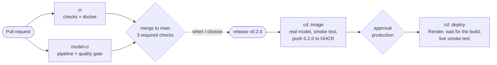

| Workflow | Runs on | What it does | Time |
| --- | --- | --- | --- |
| [`ci`](.github/workflows/ci.yml), job `checks` | every pull request and push to `main` | ruff, ruff format, strict mypy, the 326 fast tests on 4 workers | 2 to 4 min |
| [`ci`](.github/workflows/ci.yml), job `docker` | same | builds the API image with a tiny model, smoke test, no PyTorch, not root, Trivy scan | about 1 min |
| [`model-ci`](.github/workflows/model-ci.yml), job `pipeline` | every pull request | re-runs the DVC stages the change affects, comments the metrics diff, runs the quality gate | seconds without an ML change, about 1 min when no model retrains, 16 min when all of them do |
| [`cd`](.github/workflows/cd.yml) | a published release (`v*`), or by hand on one | builds with the real model, tests and pushes the image; after approval, deploys it and tests the live URL | about 2 min, plus the approval |

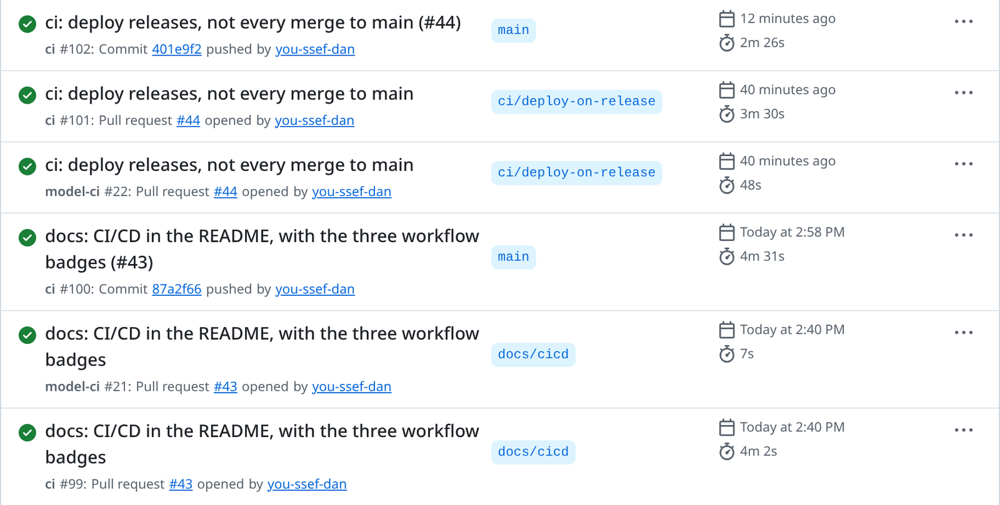

### On every pull request

**`checks`** runs what `make check` runs locally. The tests run on 4 workers
([pytest-xdist](https://pytest-xdist.readthedocs.io), `pytest -n 4`), one per CPU of GitHub's
runners: every test works in its own temporary folder, so they can run side by side. On 4 CPUs
locally this halves the time (222 s → 110 s, same tests, same 99.4% coverage); GitHub's shared
machines vary more, 108 to 221 s so far against 150 to 245 s one at a time. It is `-n 4` and not
`-n auto`, because `auto` counts physical cores and ignores how many CPUs the job may use: on the
laptop it started 14 workers and ran out of memory.

**`docker`** tests the packaging, not the model:

- The real model lives in DVC, so the job builds the image around a tiny random one
  ([`make_tiny_model.py`](scripts/make_tiny_model.py): ResNet-18, 64 px, random weights, a few
  seconds).
- [`smoke_test.sh --basic`](scripts/smoke_test.sh): the API gets ready, `/v1/model` describes
  the model, a random PNG gets a score and a heatmap, and a text file is refused (415).
- The image must not import PyTorch and must run as user 10001, not root.
- [Trivy](https://trivy.dev) fails the job on any HIGH or CRITICAL vulnerability that has a fix
  (`ignore-unfixed`: Debian lists many with no fix yet).

**`pipeline`** checks the models, with the data and models from the DVC remote on
[DagsHub](https://dagshub.com) (private, because of the MVTec license):

1. **Is it an ML change?** It compares the pull request with `main`. Code in `src/`,
   `params.yaml`, `gates.yaml`, `dvc.yaml` or `dvc.lock`, data pointers, `.dvc/config`, the
   dependencies or the workflow itself count. Anything else passes in seconds: the gate that
   passed on `main` still holds. It runs on every pull request instead of using a `paths:` filter,
   because a required check that never starts blocks the merge forever.
2. **`dvc pull data/raw/mvtec_ad.dvc dvc.yaml`.** The images are pulled explicitly: the stages read
   them through the manifest, so they are not declared inputs, and `dvc repro --pull` would skip
   them.
3. **`dvc repro`.** Only the stages whose inputs changed run again.
4. **A comment on the pull request**, edited in place on each push: the params and metrics diff
   against `main` (`dvc params diff`, `dvc metrics diff`).
5. **The quality gate.**

### The quality gate

[`gate.py`](src/anomaly_inspector/pipelines/gate.py) reads the reports DVC wrote and fails the
job if a model falls below its floor in [`gates.yaml`](gates.yaml). The floors are the current
holdout results minus about one point, rounded down:

| Category | Image AUROC floor (now) | AUPRO floor (now) |
| --- | --- | --- |
| bottle | 0.99 (1.000) | 0.93 (0.941) |
| carpet | 0.97 (0.987) | 0.93 (0.942) |
| screw | 0.88 (0.892) | 0.87 (0.885) |

Each ONNX model must also answer within the latency budget (p95 ≤ 200 ms, the
`promotion.latency_budget_ms` the registry already uses), and a missing report fails like a bad
score. ONNX and PyTorch agreeing is not re-checked: the export stage already stops when their
scores differ by 1e-3 or more. The floors have their own file because `params.yaml` is read
through `config.py`, which refuses unknown keys, and changing `config.py` would make the whole
pipeline run again for nothing.

```console
$ uv run python -m anomaly_inspector.pipelines.gate      # on main
ok    bottle  holdout_image_auroc  1.000, floor 0.990
ok    bottle  holdout_aupro        0.941, floor 0.930
ok    bottle  p95 latency          82 ms, budget 200 ms
...
all 9 gates passed
```

**It catches a bad model.** Pull request [#30](https://github.com/you-ssef-dan/anomaly-inspector/pull/30)
shrank the memory bank 100 times (`coreset_ratio` 0.01 → 0.0001). `model-ci` retrained the three
models (16 min on GitHub), commented the drop and failed at the gate, so the pull request could not
be merged and was closed:

```console
FAIL  bottle  holdout_image_auroc  0.906, floor 0.990
FAIL  bottle  holdout_aupro        0.647, floor 0.930
ok    bottle  p95 latency          151 ms, budget 200 ms
ok    carpet  holdout_image_auroc  0.995, floor 0.970
ok    carpet  holdout_aupro        0.939, floor 0.930
ok    carpet  p95 latency          143 ms, budget 200 ms
FAIL  screw   holdout_image_auroc  0.556, floor 0.880
FAIL  screw   holdout_aupro        0.522, floor 0.870
ok    screw   p95 latency          149 ms, budget 200 ms
4 of 9 gates failed
```

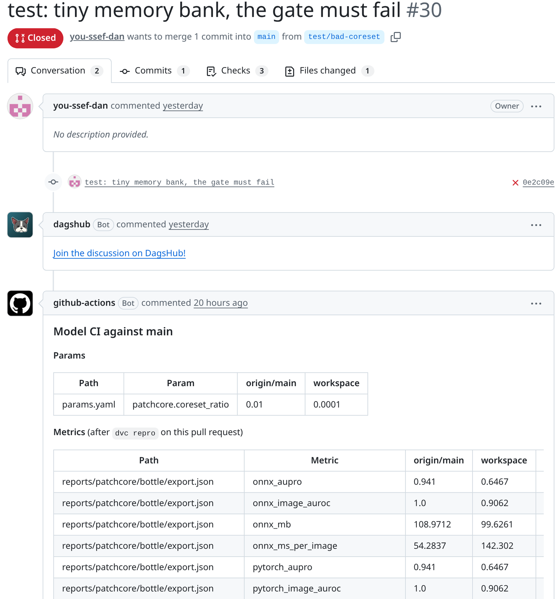

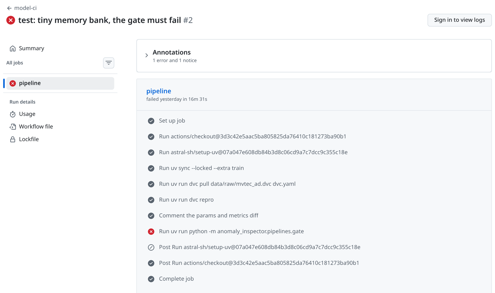

### Deploying: a release, then an approval

Merges to `main` are tested but not deployed. Dependency updates in particular change `uv.lock`
for tools the API image does not even contain (it holds 30 packages), and deploying each of them
would rebuild the same app again and again. When `main` is worth shipping, I publish a release:

```bash
gh release create v0.2.0 --generate-notes    # the notes list the pull requests since the last one
```

That starts [`cd`](.github/workflows/cd.yml), with two jobs:

1. **`image`** first checks that the release is a `v*` tag on a commit of `main`, and stops
   otherwise. It pulls only three files from DagsHub (the bottle ONNX model and the smoke test's
   two photos) with `uvx --from "dvc[s3]==3.67.1"`, so PyTorch is never installed. It builds the
   image with the version as its build (`--build-arg BUILD=0.2.0`), runs the full smoke test (a
   good bottle passes, a broken one is rejected) and pushes
   `ghcr.io/you-ssef-dan/anomaly-inspector-api:0.2.0`. A release is built once: if its image is
   already on GHCR (a re-run, or deploying it again), the job reuses it instead of overwriting it.
   No `latest` tag either.
2. **`deploy`** waits for approval in the `production` environment: I am the required reviewer,
   only `v*` release tags can deploy, and admins cannot skip it. Then it calls Render's deploy
   hook with that image, polls `/health/live` until it reports the new build (Render keeps the old
   version answering until the new one is ready), and runs the basic smoke test on the live URL.

The first release, [v0.2.0](https://github.com/you-ssef-dan/anomaly-inspector/releases/tag/v0.2.0),
went live this way: `image` took 42 s and `deploy` 51 s, 40 s of it waiting for Render, and
`/health/live` now answers `{"status":"live","build":"0.2.0"}`.

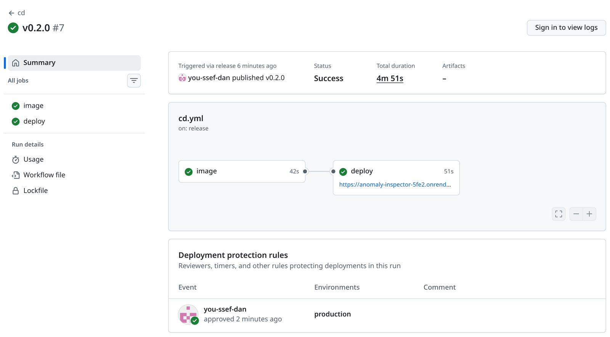

- **Approving:** *Actions* → *cd* → the waiting run → *Review deployments* → tick *production* →
  *Approve and deploy*. GitHub also notifies the reviewer.
- **One deploy at a time** (`concurrency: cd`, never cancelled halfway). A newer run replaces an
  older one that has not started yet. But a run waiting for approval holds the queue until it is
  approved or cancelled, so approve or cancel waiting runs instead of leaving them.
- **Deploying a release again:** `gh workflow run cd.yml --ref v0.2.0`. Run on a branch instead
  of a release tag, `cd` refuses.
- **Rollback:** see [Live on Render](#live-on-render). Render's *Rollback* button brings the
  previous image back without waiting for CI.

### `main` is protected

- A pull request merges only when `checks`, `docker` and `pipeline` are green **and** its branch is
  up to date with `main`, so the checks ran on exactly what will be merged. When `main` moved in
  the meantime, `gh pr update-branch <number> --rebase` updates it and the checks run again.
- Pull requests are squash-merged: one commit on `main` per change.

### Secrets: three, each where it is needed

| Secret | Stored in | Used by |
| --- | --- | --- |
| `DAGSHUB_TOKEN` | repository secrets for Actions **and** for Dependabot | `model-ci` and the `cd` image job, as `AWS_ACCESS_KEY_ID` and `AWS_SECRET_ACCESS_KEY` (DagsHub speaks the S3 protocol) |
| `RENDER_DEPLOY_HOOK` | the `production` environment | only the `cd` deploy job, so only an approved deploy of a release can read it |
| `GITHUB_TOKEN` | created by GitHub for each run | pushing to GHCR (`packages: write`, image job only) and the pull request comment (`pull-requests: write`) |

Dependabot's pull requests do not get the Actions secrets, only the Dependabot ones, so the token
is in both. Changing the token means updating three places: `.dvc/config.local`, the Actions secret
and the Dependabot secret.

### Dependabot

[`dependabot.yml`](.github/dependabot.yml) opens pull requests every week for the GitHub Actions,
the Python packages (`uv.lock`) and the Docker base images. They go through the same three checks
as any change.

- **7-day cooldown:** a release is proposed only once it is a week old, so a hijacked release has
  time to be caught before it reaches this repository.
- **Grouped:** one pull request for all the actions, one for the minor and patch Python updates;
  a major version gets its own.
- **Held back on purpose:** Python stays on 3.12 (what `uv.lock` and the tests run on), and
  `docker-compose.yml` is left out (a new major Postgres needs a migration of the MLflow data).
- **uv is a `FROM` stage** in the Dockerfiles: Dependabot only updates images named on `FROM`
  lines, so a plain `COPY --from=ghcr.io/astral-sh/uv:…` would never be updated.
- **Security alerts and security updates are on:** when an advisory is published for a
  dependency, a fix pull request opens right away, with no cooldown. On the first day it found 4
  vulnerable packages in `uv.lock`. The fixes for three went in as one pull request
  ([#41](https://github.com/you-ssef-dan/anomaly-inspector/pull/41)) instead of three. The fourth,
  diskcache (through DVC), has no fixed version yet; exploiting it needs someone who can already
  write to the DVC cache folder.

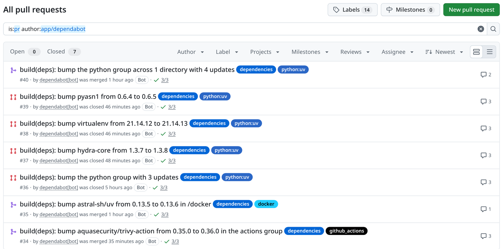

### Hardened workflows

- **Every action is pinned to a full commit SHA**, with the version in a comment. Tags can be
  moved: in March 2026 the tags of `aquasecurity/trivy-action` before 0.35.0 were pointed at
  malicious code. A pin only changes through a Dependabot pull request, and the new SHA is checked
  against the release before merging (command below).
- **Least privilege:** each workflow declares `permissions:`, read-only by default; only the jobs
  that need more get it.
- **No token left behind:** every checkout uses `persist-credentials: false`, since no job pushes
  with git.
- **No template injection:** values reach the shell through `env:`, never pasted into the command
  with `${{ … }}`.
- **No `pull_request_target`:** pull request code never runs with the repository's secrets.
- **Audited** with [zizmor](https://docs.zizmor.sh) (its online mode also checks that each pinned
  SHA belongs to its action) and [actionlint](https://github.com/rhysd/actionlint): no findings.

### Using it day to day

```bash
# Open a pull request and watch its three checks
gh pr create --fill --base main
gh pr checks --watch

# "Not up to date with the base branch": main moved, update and let the checks run again
gh pr update-branch 42 --rebase
gh pr merge 42 --squash

# Ship main: publish a release, then approve its deploy in the Actions tab
gh release create v0.2.0 --generate-notes
gh run list --workflow cd --limit 3
gh run watch <run id>
curl -s https://anomaly-inspector-5fe2.onrender.com/health/live   # {"status":"live","build":"0.2.0"}

# Deploy a release again (or an older one, to roll back): reuses its image from GHCR
gh workflow run cd.yml --ref v0.2.0

# What a change does to the models, before opening the pull request
uv run dvc repro
uv run dvc metrics diff main --md
uv run python -m anomaly_inspector.pipelines.gate

# Dependabot pull request out of date: comment on it
#   @dependabot rebase

# Store the DagsHub token as a Dependabot secret without ever printing it
uv run dvc config --local remote.dagshub.secret_access_key | gh secret set DAGSHUB_TOKEN --app dependabot

# Check that a pin matches the release: the ^{} line is the commit the tag points to
git ls-remote https://github.com/aquasecurity/trivy-action 'refs/tags/v0.36.0*'

# Audit the workflows
GH_TOKEN=$(gh auth token) uvx zizmor .github/
uvx --from actionlint-py actionlint
```

<details>
<summary><b>The settings this needs on GitHub, DagsHub and Render</b></summary>

1. **DagsHub:** a **private** repository used only as the DVC remote (S3 protocol, endpoint
   `https://dagshub.com/you-ssef-dan/anomaly-inspector.s3`), and a token from
   *Settings* → *Tokens*. The token goes in `.dvc/config.local` (ignored by git) on the laptop.
2. **Secrets:** *Settings* → *Secrets and variables* → *Actions* → `DAGSHUB_TOKEN`, and the same
   under *Dependabot*.
3. **Environment:** *Settings* → *Environments* → `production`: yourself as required reviewer,
   deployments limited to the tag rule `v*` (*Deployment branches and tags* → *Add deployment
   branch or tag rule* → *Tag*), *Allow administrators to bypass* off. Its secret
   `RENDER_DEPLOY_HOOK` is the whole deploy hook URL from Render (*Settings* → *Deploy Hook*).
4. **GHCR:** the package was first pushed from the laptop, so Actions could not push to it
   (`permission_denied: write_package`): *Package settings* → *Manage Actions access* → add the
   repository with the *Write* role.
5. **Branch protection** on `main`: required checks `checks`, `docker`, `pipeline`, and
   *Require branches to be up to date before merging*.
6. **Dependabot:** *Settings* → *Advanced Security* → enable *Dependabot alerts* and *Dependabot
   security updates*. Version updates start on their own once `dependabot.yml` is on `main`.

</details>

**Where this differs from the [Phase 8 plan](guides/phases/08-ci-cd-github-actions.md):**

- **DagsHub instead of Cloudflare R2** for the DVC remote: R2 needs a card, DagsHub's free plan
  holds the 2 GB. The cost: its token opens the whole DagsHub account, not one bucket.
- **Render instead of Cloud Run**, so no Google Cloud OIDC either. There are no cloud keys at all,
  but the deploy hook URL is a long-lived secret, which is why only the approved deploy job can
  read it.
- **The floors are in `gates.yaml`**, not a `gates` section of `params.yaml` (see the quality gate).
- **`dvc pull` then `dvc repro`** instead of `dvc repro --pull`, which would not fetch the images.
- **A release deploys, not every merge.** At first `cd` ran on every merge that touched the image's
  inputs, but `uv.lock` changes for dev tools too (pytest-xdist, virtualenv), so it kept deploying
  identical apps. A `develop` branch would have solved it with two pull requests per change; a
  release keeps a single `main` and makes shipping a deliberate step.

## Retraining and batch inspection with Airflow

Two [Airflow 3](https://airflow.apache.org) DAGs run on the laptop without me.
`retrain_patchcore` turns photos that people confirmed good into a new model and proposes it in a
pull request. `batch_inspection` scores the factory line every 10 minutes. Airflow only
orchestrates: every ML step runs in the training image, and scoring is the API's job. And it never
deploys: a new champion becomes a pull request, CI checks it, I merge it, and a release ships it.

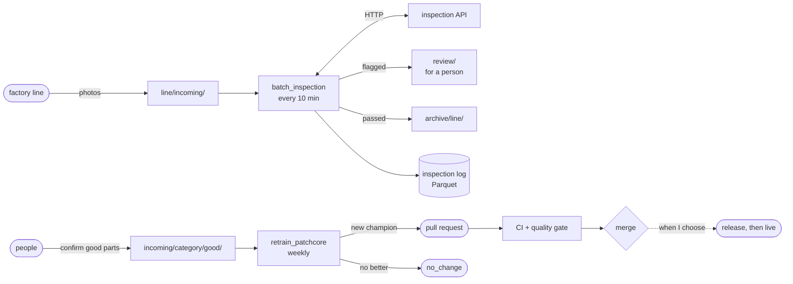

### Retraining: `retrain_patchcore`

Weekly (Sunday, 00:00 UTC), one run at a time, on Airflow's own clone of this repository, so its
git commands never touch the copy I work in. Steps marked *training image* run in
`anomaly-inspector-train` through `DockerOperator`, so the Airflow image needs no PyTorch.

| Task | Runs in | What it does |
| --- | --- | --- |
| `new_data_ready` | Airflow | Are there at least 20 confirmed photos for a category? If none has, the run stops here. |
| `start_branch` | training image | A `retrain/<time>` branch from `origin/main`, then `dvc pull`. Refuses to run if the image was built from another `uv.lock` than main's. |
| `ingest` | training image | Copies the new photos into the training data, skipping any image the category already has (by SHA-1), then `dvc add` and a **commit**. Nothing new: the rest of the run is skipped. |
| `retrain` | training image | `dvc repro`: train, evaluate (an MLflow run), export to ONNX, optimise. |
| `register` | training image | Each retrained category becomes the MLflow challenger, and the promotion rules decide if it is the new champion. Its last line, like `{"bottle": true}`, goes to `decide`. |
| `decide` | Airflow | A new champion: `open_pull_request`. None: `no_change`. |
| `open_pull_request` | training image | Commits `dvc.lock` and the reports, `dvc push`, pushes the branch and opens the pull request through the GitHub API. Safe to retry. |
| `archive_incoming` | Airflow | Moves the photos the pull request carries to `archive/confirmed/<run>/`, so they never count twice. |
| `no_change` | Airflow | Nothing proposed, nothing deployed. The photos stay in `incoming/` for the next run. |

Two rules shape it:

- **Only photos a person confirmed.** Training on the model's own decisions would teach it its
  own mistakes.
- **The data is committed before training.** A run from uncommitted code or data can never become
  champion ([the promotion rules](#tracking-and-model-registry)): image AUROC not lower, AUPRO at
  most 0.005 lower, at most 200 ms per image, clean git. Committing first makes the run promotable.

#### Tested both ways

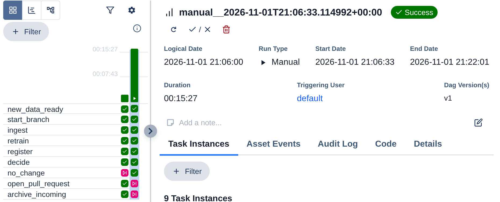

| Run | Input | Result |
| --- | --- | --- |
| 1, scheduled | 20 confirmed good bottle photos from the simulator | New champion (v4). The DAG opened [PR #49](https://github.com/you-ssef-dan/anomaly-inspector/pull/49); `model-ci` passed in 53 s without retraining (the models were already in DVC); merged |
| 2, by hand | 20 **mislabeled** photos: defective bottles from the holdout set (broken, contaminated), saved again under new names (same pixels, new SHA-1), as if a person had confirmed them good | Challenger v5 only: image AUROC **0.706** (champion 1.0), AUPRO **0.434** (0.936). `no_change`: no branch pushed, no pull request, nothing deployed |

The second run is the one that matters: bad labels made a worse model, and the rules kept it away
from production. A run takes 15 to 25 minutes, most of it in `dvc repro`, which re-runs all three
categories because they share one manifest. The training container peaked at 3.3 GB.

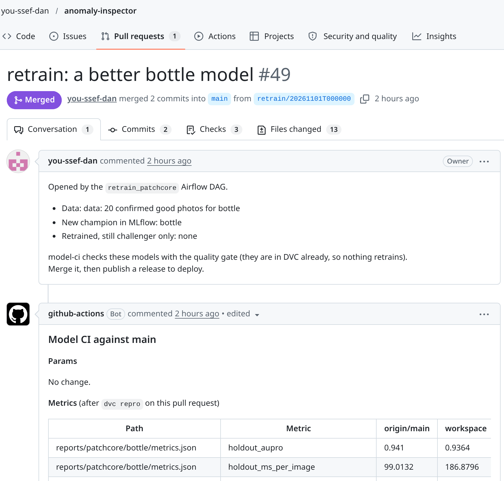

What PR #49 shows:

- **"A better model" means "not worse, by the rules".** Image AUROC stayed at 1.0, and AUPRO went
  from 0.941 to 0.9364: 0.0046 lower, inside the 0.005 tolerance by a hair. Twenty more good
  photos cannot improve much on a category that is already perfect at flagging.
- **Latency went from 99 to 187 ms per image**, because it was measured inside the Airflow run,
  next to the rest of the stack. That is close to the 200 ms budget: on a busy laptop, a good model
  could be rejected for speed alone.
- **Its first try failed after pushing the branch.** The GitHub token had no *Pull requests*
  permission (403). The retry then stopped at `git commit`, because the commit was already there.
  The script now skips a commit that exists
  ([#48](https://github.com/you-ssef-dan/anomaly-inspector/pull/48)), and the retry opened the
  pull request.

### Batch inspection: `batch_inspection`

Every 10 minutes, one run at a time.

| Task | What it does |
| --- | --- |
| `list_new_images` | The photos in `line/incoming/`, in chunks of 10. A photo still being copied ends in `.part`, so it waits for the next run. No photos: the rest is skipped. |
| `score_chunk[i]` | One task per chunk, created at run time (dynamic task mapping) and run in parallel. `POST /v1/predict` for each photo, as the line's PC would. 3 retries with backoff if the API is down. Only names and scores go through XCom, never pixels. |
| `store_and_route` | Writes every result to the inspection log **first**, then moves each photo: flagged to `review/`, passed to `archive/line/<day>/`. |

The log is one Parquet file per run in `inspection_log/date=<day>/`. A retry rewrites the same file
and skips the photos already moved, so no result is lost or counted twice. Phase 10's drift report
will read it.

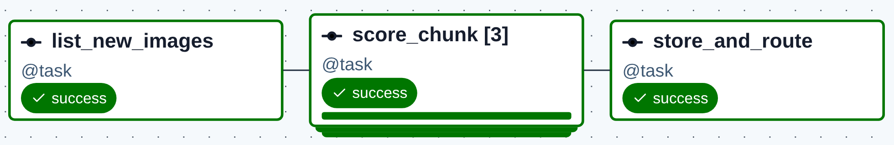

The test: the simulator put 25 photos on the line, 10 of them defective. The decisions, against the
truth it wrote in `line/labels.csv`:

| Truth | Sent to `review/` | Sent to `archive/` |
| --- | --- | --- |
| broken_large (4) | 4 | 0 |
| broken_small (5) | 5 | 0 |
| contamination (1) | 0 | **1** |
| good (15) | 0 | 15 |

- The run took 3 seconds. The missed contamination scored under the threshold, so it was archived
  and no one will look at it. Phase 10 measures these misses against the truth.
- The median was 730 ms per photo, because three chunks hit the API's 2 CPUs at once. Fine at this
  volume.
- Running `store_and_route` a second time by hand left the log at one file of 25 rows. A run with
  an empty line succeeds and skips the scoring.

Two rows of the log (it also has `category`, `scored_at`, `run_id`, and `date` from the folder):

| filename | anomaly_score | threshold | is_anomalous | model_version | latency_ms |
| --- | --- | --- | --- | --- | --- |
| `20261101T213446Z-2f5b658e.png` | 1.489 | 2.242 | false | `4b5af98…` | 805 |
| `20261101T213446Z-acc678e6.png` | 2.991 | 2.242 | true | `4b5af98…` | 456 |

### The factory, simulated

[`scripts/simulate_line.py`](scripts/simulate_line.py) stands in for the camera and for the people
(standard library only):

- **The line.** Every tick (5 minutes by default) it puts a batch of photos in `line/incoming/`:
  good parts from the simulation pool, the 20% of each category's good training photos held back
  since Phase 1 so training never saw them, mixed with real defects from the test set (10% by
  default). File names give nothing away; the truth goes to `line/labels.csv`.
- **The people.** It confirms a few pool photos good (2 per tick by default) into
  `incoming/<category>/good/`, each one once at most.

Copies are atomic (a `.part` name, then a rename), so a DAG never reads half a photo.

### How it runs on a laptop

```
~/airflow-workspace/
  industrial-anomaly-detection/   Airflow's own clone of this repository
  incoming/<category>/good/       confirmed good photos, waiting for a retrain
  line/incoming/                  photos from the line, waiting for inspection
  line/labels.csv                 the truth about each of them, from the simulator
  review/                         flagged photos, for a person
  archive/confirmed/<run>/        photos a retraining pull request carries
  archive/line/<day>/             photos that passed
  inspection_log/date=<day>/      one Parquet file per batch_inspection run
```

[`airflow/docker-compose.yaml`](airflow/docker-compose.yaml) is the official Airflow 3.3.2 file,
changed for the laptop:

- **LocalExecutor:** tasks run in the scheduler, so no Redis, Celery worker or Flower (about 640 MB
  saved). At most 4 tasks at once.
- **The scheduler gets the Docker socket**, to start the training image, and the workspace at the
  same absolute path as on the host, because `DockerOperator` mounts host paths.
- **One shared network, `inspection`**, created by the main `docker-compose.yml`: Airflow reaches
  `mlflow:5000` and `api:8000` by name.
- **The UI listens on 127.0.0.1 only.** No example DAGs.

At rest, Airflow's five containers use about 0.9 GB, and 1.5 GB with MLflow and the API. MLflow's
background job workers are off (`MLFLOW_SERVER_ENABLE_JOB_EXECUTION=false`): this project does not
use them, and they took about 1.5 GB.

**Secrets.** Two tokens, and only the scheduler gets them:

- **GitHub:** a fine-grained token for this repository only, with *Contents* and *Pull requests*
  read and write, in `airflow/.env` (ignored by git). Only `open_pull_request` receives it, and git
  gets it through a credential helper, never in a URL.
- **DagsHub:** not in Airflow's `.env`. `make airflow-up` reads it from `.dvc/config.local`, so it
  has one copy on disk, and [`scripts/rotate_dagshub_token.sh`](scripts/rotate_dagshub_token.sh)
  replaces it everywhere (DVC, the two GitHub secrets, Airflow) from one hidden prompt.

The training containers get both as `private_environment`, which Airflow hides in the UI and logs.

### Using it day to day

```bash
make train-image   # once, and after each uv.lock change: start_branch refuses an older image
make airflow-up    # MLflow, the API, then Airflow: http://localhost:8080 (airflow / airflow)

# The line: 10 photos every 5 minutes (--confirm 0: no confirmed photos, so no retraining)
python3 scripts/simulate_line.py --confirm 0
# 20 confirmed good photos at once: enough for a retrain
python3 scripts/simulate_line.py --ticks 1 --batch 0 --confirm 20

cd airflow
# Retrain now rather than on Sunday (the logical date names the branch)
docker compose exec airflow-scheduler airflow dags trigger retrain_patchcore \
  -l "$(date -u +%Y-%m-%dT%H:%M:00+00:00)"
# Re-run a failed task and what follows it, in the runs of that day
docker compose exec airflow-scheduler airflow tasks clear retrain_patchcore \
  -t open_pull_request -d -s 2026-11-01 -e 2026-11-02 --yes
# Stop the 10-minute inspection, or start it again
docker compose exec airflow-scheduler airflow dags pause batch_inspection
docker compose exec airflow-scheduler airflow dags unpause batch_inspection
cd ..

# Read the inspection log
uv run python -c "import os, pandas as pd; print(pd.read_parquet(os.path.expanduser('~/airflow-workspace/inspection_log')))"

make airflow-down
```

<details>
<summary><b>Setting it up the first time</b></summary>

1. **The workspace and Airflow's clone.** The DagsHub token comes from the environment, so the
   clone gets no copy of it, and `uvx` runs DVC alone, so the clone needs no environment of its
   own (the DAG's steps use the training image's):

   ```bash
   mkdir -p ~/airflow-workspace/{incoming,line/incoming,review,archive}
   git clone https://github.com/you-ssef-dan/anomaly-inspector.git \
     ~/airflow-workspace/industrial-anomaly-detection
   token="$(uv run dvc config --local remote.dagshub.secret_access_key)"   # in this repository
   cd ~/airflow-workspace/industrial-anomaly-detection
   AWS_ACCESS_KEY_ID="$token" AWS_SECRET_ACCESS_KEY="$token" uvx --from "dvc[s3]==3.67.1" dvc pull
   unset token
   ```

2. **The GitHub token:** *Settings* → *Developer settings* → *Fine-grained tokens* → *Generate new
   token*. *Only select repositories*: this one. *Repository permissions*: *Contents* and *Pull
   requests*, read and write (*Metadata* read-only is added for you).
3. **Airflow's settings:** `cp airflow/.env.example airflow/.env`, `chmod 600 airflow/.env`, then
   fill it in. Each line says where its value comes from.
4. **Start:** `make train-image`, `make mlflow-up api-up` (it creates the `inspection` network),
   then `cd airflow && docker compose up airflow-init`, then `make airflow-up`. Both DAGs start
   paused: unpause them in the UI.

</details>

**Where this differs from the [Phase 9 plan](guides/phases/09-airflow-orchestration.md):**

- **The data is committed by `ingest`, before `dvc repro`**, not with the results at the end:
  otherwise the training run comes from a dirty tree, and the promotion rules refuse it.
- **`register --category`** for the categories that had new photos, not `--all`; `--all` still
  exists.
- **The DagsHub token instead of R2 keys**, as in Phase 8, with one copy on disk.
- **Chunks of 10 photos, not 25**, so the usual 10-minute batch (about 20 photos) still splits.
- **One Parquet file per run** in dated folders, rather than appending to one file: Parquet files
  cannot be appended to, and a retry overwrites its own file.

## Quick start

You need [uv](https://docs.astral.sh/uv/) (it installs Python 3.12 for you) and `make`.

```bash
git clone https://github.com/you-ssef-dan/anomaly-inspector.git
cd anomaly-inspector
make setup     # installs everything, including the git hooks
make check     # lint, types and tests
```

The tests need **no dataset**: they run on a tiny fake one that the test suite generates. PyTorch is
installed as the CPU build, so there is no GPU or CUDA download.

| Command | What it does |
| --- | --- |
| `make setup` | Install all dependencies and the pre-commit hooks |
| `make check` | Ruff, strict mypy and the fast tests (what CI runs) |
| `make test-slow` | Tests that need the optional `bench` extra, such as the comparison with anomalib |
| `make bench` | Benchmark PatchCore against anomalib on all categories (needs the data and several GB of RAM) |
| `make mlflow-up` / `make mlflow-down` | Start or stop MLflow and PostgreSQL (needs Docker and a `.env`) |
| `make api-up` / `make api-down` | Start or stop the API in Docker, with 2 CPUs and 1 GB: http://localhost:8000/docs |
| `make smoke` | Smoke test of the running API: ready, a good part passes, a defective one is rejected |
| `make train-image` | Build the training image that the retraining DAG runs its steps in |
| `make airflow-up` / `make airflow-down` | Start MLflow, the API and Airflow (http://localhost:8080), or stop Airflow ([setup](#retraining-and-batch-inspection-with-airflow)) |

To train, evaluate and register the models (needs the data, Docker and about 4 GB of free RAM):

```bash
cp .env.example .env    # then put a real password in it
make mlflow-up          # the UI is at http://localhost:5000
uv run --env-file .env dvc repro                                   # every category; re-runs only what changed
uv run --env-file .env python -m anomaly_inspector.pipelines.register --category screw   # or --all
```

Without `--env-file`, `dvc repro` writes exactly the same files, just without MLflow runs.

To rebuild the processed data you need the dataset itself. The [data card](docs/data_card.md)
explains where to get it, how it is verified and how it is split.

## How the project is organised

```
src/anomaly_inspector/
  preprocessing.py   one image function shared by training and serving; numpy + Pillow only
  config.py          typed settings read from params.yaml
  tracking.py        what every MLflow run records (code, data and hardware tags, params)
  registry.py        champion and challenger: the promotion rules
  data/              manifest, validation, splits, PyTorch Dataset
  models/            PatchCore, STFPM, backbones
  training/          STFPM training loop (seeded, early stopping, best checkpoint)
  evaluation/        AUROC, AUPRO, thresholds, ROC and PRO curves, failure gallery
  export/            ONNX export with metadata, INT8 quantisation, latency benchmark
  pipelines/         one entry point per DVC stage: prepare, then train, evaluate, export, optimise;
                     and the retraining DAG's steps: ingest new photos, register in MLflow
  serving/           the FastAPI app, the ONNX inference wrapper, the heatmap (no PyTorch)
scripts/             training with MLflow logging, benchmark vs anomalib, experiments, gallery,
                     the smoke test and the tiny model CI builds the image with, the factory
                     simulator, the retraining pull request, the DagsHub token rotation
docker/              the API, training and MLflow images (docker-compose.yml runs MLflow and the API)
airflow/             Airflow 3 in Docker Compose, and the retrain_patchcore and batch_inspection DAGs
.github/             the ci, model-ci and cd workflows, and the Dependabot settings
tests/               unit and API tests on generated fake data, slow tests, a Locust load test
notebooks/           exploratory data analysis (no outputs stored in git)
docs/                data card, experiment findings
reports/             benchmark and experiment results, charts, heatmap gallery, failure notes
params.yaml          every tunable value, validated at load time
gates.yaml           the scores every model must keep (the quality gate)
dvc.yaml             the pipeline, from raw images to a model and its reports per category
```

## Engineering choices

- **No data in git.** Images and models are versioned with [DVC](https://dvc.org); git keeps small
  pointer files. Given the data, a clean clone rebuilds a byte-identical manifest with `dvc repro`.
- **Honest evaluation.** The data is split into `train`, `val_normal`, `calib` and `holdout`.
  Every decision (thresholds, settings) is made on `calib`; the reported numbers come from
  `holdout`. Nothing is tuned on the test set.
- **Every run traceable, promotion by tested code.** Each MLflow run records its commit, data
  hash and settings; a run from uncommitted code can never become the champion.
- **Same preprocessing everywhere.** One function, with a golden-file test, so training and serving
  cannot drift apart.
- **Reproducible.** Fixed seeds, a locked environment (`uv.lock`) and validated configuration.
- **Checked on every change.** Strict typing, lint, hooks that block large files, notebook outputs
  and secrets, and CI on every pull request. `main` is protected: changes arrive through up-to-date
  pull requests that pass `checks` (lint, types, tests), `docker` (the image builds, answers its
  smoke test and has no fixable high or critical vulnerability) and `pipeline` (the models still
  pass the quality gate). A deploy is a release, and needs a human approval. See [CI/CD](#cicd).
- **Careful with the supply chain.** Actions pinned to commit SHAs, least-privilege tokens,
  Dependabot with a 7-day cooldown, and an image scan on every pull request.
- **Automation proposes, people decide.** Airflow retrains only on photos people confirmed, never
  on its own decisions, and a new champion becomes a pull request that CI checks. Nothing it does
  reaches production without a merge and a release. See [Airflow](#retraining-and-batch-inspection-with-airflow).

## Roadmap

✅ done · 🚧 in progress · ⬜ planned

| Phase | What | Status |
| --- | --- | --- |
| 0 | Repo foundations: uv, ruff, mypy, pytest, pre-commit, CI, branch protection | ✅ |
| 1 | Data and DVC: manifest, validation, splits, preprocessing, EDA, data card | ✅ |
| 2 | Models in PyTorch: PatchCore, STFPM, metrics, anomalib benchmark, experiments, heatmap gallery | 🚧 |
| 3 | Experiment tracking and model registry with MLflow | ✅ |
| 4 | Full DVC pipeline: train, evaluate, export per category | ✅ |
| 5 | ONNX export, optimisation and quantisation | ✅ |
| 6 | FastAPI inference service with pytest | ✅ |
| 7 | Docker and a first deployment | ✅ |
| 8 | CI/CD with GitHub Actions, including model quality gates | ✅ |
| 9 | Retraining and batch inspection with Airflow (next: the DAG tests in CI) | 🚧 |
| 10 | Monitoring and the feedback loop | ⬜ |

## Data and license

The code is [Apache-2.0](LICENSE). The images are **not** part of this repository: MVTec AD is
licensed [CC BY-NC-SA 4.0](https://creativecommons.org/licenses/by-nc-sa/4.0/) (non-commercial), so
models trained on it are for learning and portfolio use. If you use the dataset, please cite:

> Paul Bergmann, Michael Fauser, David Sattlegger and Carsten Steger,
> *A Comprehensive Real-World Dataset for Unsupervised Anomaly Detection*, CVPR 2019.
