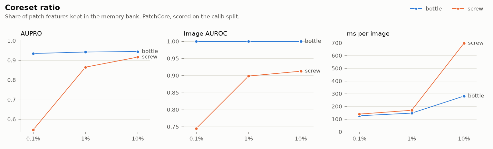
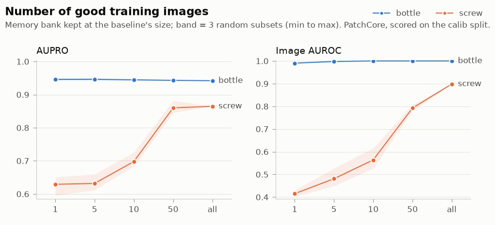
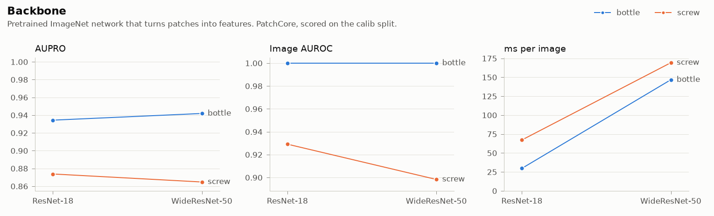

# Phase 2 experiments: what changes the result, and what it costs

Four questions an engineering manager would ask before putting PatchCore on a line, answered on two
categories: **bottle** (easy: identical parts, large defects) and **screw** (hard: parts at any
angle, tiny defects).

- **Model:** this repo's PatchCore. Baseline: WideResNet-50, 256 px, 1% coreset, all training images.
- **Method:** each run changes **one** setting of the baseline: 18 runs per category, plus one
  combination of two of the changes (section 5). All in
  [`reports/experiments.json`](../reports/experiments.json); every number is in the generated table
  [`reports/experiments.md`](../reports/experiments.md).
- **Scored on the `calib` split** (bottle: 10 good + 31 defective; screw: 20 good + 60 defective).
  These runs *choose* settings, so `holdout` stays untouched for the final numbers.
- **AUPRO** is the main metric: it counts every defect region equally, so tiny defects matter.
  Image AUROC says whether a part is flagged; AUPRO says how well the defect is located.

## The short answers

| Question | Bottle | Screw |
| --- | --- | --- |
| **How much accuracy does a smaller memory bank cost?** | Almost none: 100× smaller, AUPRO 0.944 → 0.934 | A lot: AUPRO 0.916 → 0.865 → **0.546** at 10% / 1% / 0.1% |
| **How many good parts does a new line need?** | One image already gives image AUROC 0.99 | About **50**, and they must show the part at different angles |
| **What does a faster backbone cost?** | AUPRO −0.008, **5× faster** | Nothing measurable here, **2.5× faster** |
| **Do small defects need more resolution?** | A little: AUPRO 0.942 → 0.953 | **Yes**: AUPRO 0.865 → **0.941**, image AUROC 0.898 → 0.976 |

For screw, the best use of extra compute is **resolution**, not a bigger memory bank: 256 → 320 px
gains +0.076 AUPRO for 2.5× the latency, while 1% → 10% gains +0.051 for 4× the latency and 9× the
fit time.

**The best setting found is the combination of the two cheap wins:** ResNet-18 at 320 px. On screw it
reaches AUPRO **0.962** (baseline 0.865) at **38 ms per image** (baseline 169) and 2.5 GB of RAM
(baseline 3.7); on bottle it matches the baseline's accuracy at a quarter of the latency. See
section 5 for what that does and does not prove.

## 1. Coreset ratio

<picture>
  <source media="(prefers-color-scheme: dark)" srcset="../reports/figures/experiment_coreset_dark.png">
  
</picture>

- Bottle barely notices the memory bank size: its good parts look the same, so a few patches cover
  them. Screw needs a rich bank: at 0.1% (235 patches) it collapses to AUPRO 0.55.
- The cost grows faster than the benefit. At 10%, fitting takes **470 s on bottle and 1,069 s
  (18 min) on screw**, and each image takes 2 to 4× longer to score.
- 1% is the sensible default on both.

## 2. Number of good training images

<picture>
  <source media="(prefers-color-scheme: dark)" srcset="../reports/figures/experiment_images_dark.png">
  
</picture>

The memory bank is kept at the baseline's size, so the only thing that changes is how much variety
the bank was built from. Each point is the mean of 3 random subsets; the band is min to max.

- **Bottle:** AUPRO is flat at about 0.945 from a single image; image AUROC reaches 1.0 at 10
  images.
- **Screw:** with 1 to 5 images, image AUROC is **below 0.5** (0.42 and 0.48): good screws that lie
  at another angle than the stored ones look *more* anomalous than the defective ones. This fits
  what the data analysis showed (screws are placed at any angle), but this run does not isolate that
  cause. At 50 images AUPRO is 0.860, within 0.005 of using all 230, while image AUROC is still
  0.79 against 0.90.

## 3. Backbone

<picture>
  <source media="(prefers-color-scheme: dark)" srcset="../reports/figures/experiment_backbone_dark.png">
  
</picture>

- ResNet-18 is **5× faster on bottle (30 vs 147 ms per image) and 2.5× on screw (67 vs 169 ms)**,
  with half the RAM (1.3 and 1.6 GB against 2.7 and 3.7 GB), and a memory bank 4× smaller.
- On bottle it loses 0.008 AUPRO. On screw it is slightly *ahead* (AUPRO 0.874 vs 0.865, image AUROC
  0.929 vs 0.898), but those gaps are inside the noise (see below), so read it as "at least as
  good", not "better".

## 4. Image size

<picture>
  <source media="(prefers-color-scheme: dark)" srcset="../reports/figures/experiment_size_dark.png">
  
</picture>

Every map is scored on 256 px masks, whatever size the model ran at, so sizes are comparable.

- Resolution helps both, and helps **screw most**: AUPRO 0.851 → 0.865 → 0.941 for 224 → 256 → 320
  px, and image AUROC 0.880 → 0.898 → 0.976. At 256 px the median screw defect covers about 3 cells
  of PatchCore's feature grid and the smallest about 1 (see the data card); a larger input gives
  them more cells.
- The price: screw latency 169 → 425 ms, fit time 117 → 487 s, and **5.5 GB of peak RAM** (3.7 GB
  at 256 px). That is most of this laptop's memory.

## 5. One combination: ResNet-18 at 320 px

The two cheap wins from sections 3 and 4, together. It was the one combination tried, chosen
because the single changes pointed at it.

| | Image AUROC | Pixel AUROC | AUPRO | ms per image | RAM | Fit |
| --- | --- | --- | --- | --- | --- | --- |
| **screw**: baseline (WideResNet-50, 256 px) | 0.898 | 0.977 | 0.865 | 169 | 3.7 GB | 117 s |
| screw: WideResNet-50, 320 px | 0.976 | 0.990 | 0.941 | 425 | 5.5 GB | 487 s |
| screw: **ResNet-18, 320 px** | 0.963 | 0.994 | **0.962** | **38** | 2.5 GB | 189 s |
| **bottle**: baseline | 1.000 | 0.987 | 0.942 | 147 | 2.7 GB | 67 s |
| bottle: WideResNet-50, 320 px | 1.000 | 0.988 | 0.953 | 252 | 3.9 GB | 143 s |
| bottle: **ResNet-18, 320 px** | 1.000 | 0.985 | 0.948 | **37** | 1.7 GB | 69 s |

- **Screw:** the effects roughly add up (+0.009 from the backbone, +0.076 from the size, +0.097
  together). The combination scores the best AUPRO of all 19 runs, **11× faster** than
  WideResNet-50 at the same size and in half the RAM. Its image AUROC is a little lower than the
  big backbone's (0.963 vs 0.976), a gap that 20 good images cannot resolve.
- **Bottle:** 4× faster than the baseline with slightly better AUPRO (+0.007); the big backbone at
  320 px is a bit more accurate still (0.953) but 7× slower.
- **Not yet proven.** It is one run per category, picked *after* looking at these `calib` results.
  The honest test is `holdout`, which no decision has touched. Until then, treat it as the
  strongest candidate, not as the result.

## How far to trust this

- **Small score sets.** The `calib` split holds 10 and 20 good images, so image AUROC moves a lot
  with a single image.
- **Noise is large on screw.** Three random subsets of 50 training images differ by **0.036 AUPRO**
  (bottle: 0.001). Treat screw differences below about 0.03 as unproven: this covers the backbone
  gap and 224 vs 256 px. The effects that stand out are the 0.1% coreset, the 1 to 10 image runs
  and 320 px.
- **One run per setting** apart from the image-count experiment, and one seed for the coreset.
- **One change at a time**, apart from the single combination in section 5. Other combinations,
  such as a bigger coreset on top of it, are untested.
- **Speed is measured on one laptop** (Intel Core Ultra 5 125H, CPU only) and includes only the
  model, not image decoding.

## Reproduce

```bash
uv run python scripts/run_experiments.py --category screw   # 19 runs, resumable, about 55 min
uv run python scripts/plot_experiments.py                   # charts and the table
```

Close other applications first: the 320 px runs peak at 5.5 GB of RAM. Each run is its own process,
so memory is released between runs, and finished runs are skipped when you start again.
